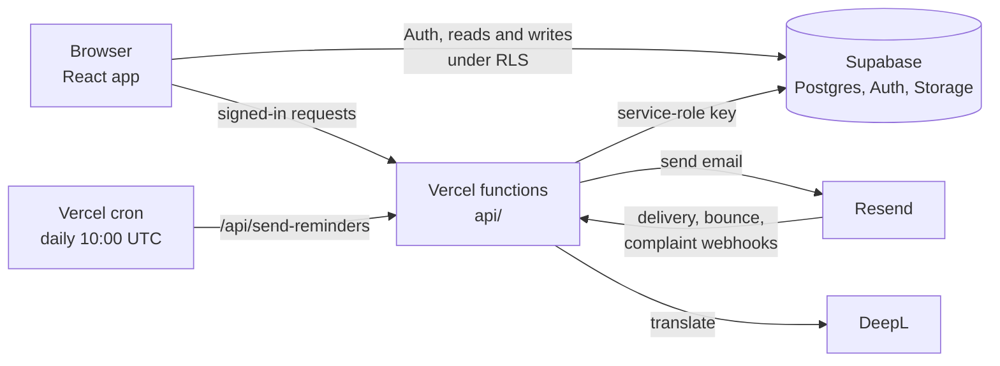

# Architecture

Loopy is a React single-page app talking to Supabase, plus a small set of serverless functions for anything that needs a secret key.

## Who talks to what

- **The browser** signs users in with Supabase Auth and reads and writes clinic data directly. Row Level Security decides what each role (volunteer, staff, admin) can see or change.
- **Public registration** goes through the `register_visit` database function, so the public form needs no direct access to the client, pet, or vaccination tables.
- **Serverless functions** (`api/`) handle everything that needs a secret: sending email, verifying webhooks, inviting users, and calling DeepL. Protected endpoints check the caller's role first (see `api/_auth.js`).
- **Resend** sends post-clinic and reminder emails and reports delivery events back through a signed webhook (verified with `svix`).
- **Certificates and waivers** are generated in the browser with `pdf-lib`.

## Roles

Each user's role lives in their Supabase JWT (`app_metadata.role`): `volunteer`, `staff`, or `admin`. See the README for which pages each role can open.

## Database

Schema changes are in `supabase/migrations/`, applied in order. Apply them to the live project deliberately; there is a separate dev project for testing. See the README's Database section for the Row Level Security overview.
